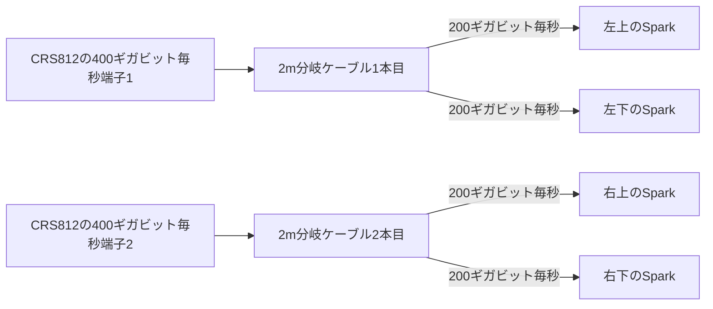

# 最終接続はCRS812と2m分岐ケーブルを使う

2026年10月12日のユーザー指定で、最終構成をMikroTik CRS812-8DS-2DQ-2DDQ-RM 1台と、NADDODのMikroTik互換Q2Q56-400G-CU2（2m）へ確定しました。当初のリング接続は維持します。CRS804との共用と、最終接続で40cm／50cmを使う条件は外します。

製品の選定と、購入・到着・実機動作の確認は区別します。購入先は[GETICのCRS812](https://www.getic.com/product/mikrotik-crs812-8ds-2dq-2ddq-rm)と[NADDODの分岐ケーブル](https://www.naddod.com/products/103563.html)です。購入完了、ケーブルの注文数、到着は未確認です。

## 分岐ケーブル2本で4台へ各200ギガビット毎秒を割り当てる

このケーブルは、400ギガビット毎秒の接続用端子1個を、200ギガビット毎秒の接続用端子2個へ分ける銅線ケーブルです。スイッチ側がQSFP-DD、Spark側がQSFP56という端子形式です。CRS812には400ギガビット毎秒端子が2個あり、[メーカーの対応表](https://manual.mikrotik.com/docs/wired-connections/mikrotik-wired-interface-compatibility/)も1端子を200ギガビット毎秒の2接続へ分ける設定を示しています。

各Sparkを1接続とする設計前提では、必要数は分岐ケーブル2本です。これは接続数から計算した必要数で、注文・所有数の確認ではありません。Spark各台の両方の高速端子を同時に使う構成は、この案に含めません。

左右の列へ1本ずつ割り当てる配線候補です。実端子の位置と分岐線の長さを確認してから割当を確定します。スイッチ側にある別の200ギガビット毎秒端子2個は、この接続案では使いません。端子形式や速度の対応と、選定したケーブルの実機認識・安定動作は別に検証します。

## 短い経路より、余長と交換経路を優先する

従来案は、スイッチの端子を上下のSparkの間へ寄せて40cm／50cmに収めることを重視していました。最終接続が2mの分岐ケーブルになったため、印刷部品を主構造とする再設計では次を優先します。

- 本体の段位置を固定し、リングからスイッチへ移行しても棚を動かさない。
- スイッチの吸排気、電源線2本、交換できる電源とファンの操作経路を確保する。
- 分岐部2か所と余長を、Sparkの排気と本体・スイッチの取り出し経路から外す。
- ケーブル保持部を開放できる形にし、交換時にケーブル全体を枠の穴へ通し直す必要をなくす。

NADDODの製品ページは最小曲げ半径を37〜42mmと記載しています。最終配線の暫定設計下限は42mmとし、従来の仮値20mmを流用しません。主線と分岐線への適用、中心線か内側かという半径の測定基準は確認が必要です。

公称2mだけでは、各分岐線の使用可能長は分かりません。主線長、分岐線2本の長さ、分岐部と端子の外形、公称長の測定基準が未確定のため、配線の実経路・余長収納・抜き差しを確認済みとは扱いません。

## CRS812の寸法と支持方法には未確定値が残る

GETICと既存の製品資料は本体443×268×44mm、[公式取扱説明](https://manual.mikrotik.com/hardware/crs812-8ds-2dq-2ddq-rm/)は443×156×44mmを記載しています。奥行268mmを参考収容寸法として維持し、最終寸法は確認後に採用します。取付耳込み幅、質量、支持面、端子と電源の突出、吸排気方向は未確定です。

公式取扱説明には、付属の取付耳でラックへ固定する方法と、底部のゴム足を使って机上へ置く方法があります。耳を外した筐体支持を採用する場合も、支持面と抜け止めを設計し、外形が枠へ入るだけで取付完了とは扱いません。スイッチは交流電源入力2個と交換可能なファン4個を持ちます。外部から手を入れて交換できる経路が必要です。

## 選定記録と検討画面を区別する

採用機器と出典は[configuration.json](../reference/selected-network-20261012/configuration.json)、接続数と分岐構成の検査は[network_configuration.py](../source/network_configuration.py)に記録します。[未確定値](../reference/pending-mount-measurements.json)も維持します。

従来の`layout:spark-rack`と`overview:spark-rack`は、再設計前の3配置を比較する画面です。最終構成の情報を併記しますが、旧画面の40cm計算と4本の独立配線を、今回の分岐ケーブルの経路や棚位置へ採用しません。段位置、電源区画、交換経路を反映した印刷構造の再設計は進行中です。
