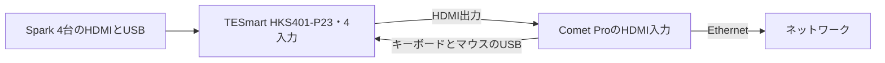

# 上下のSparkの間へ遠隔操作機器の棚を置く

GL.iNet Comet Pro（GL-RM10）は維持し、4台の映像・キーボード・マウスを切り替える機器はTESmart HKS401-P23へ変更する予定です。2026年10月14日、ユーザーからKCEVEの切替器は問題があって使えないとの報告がありました。問題の詳細は未確認です。[指定の公式販売ページ](https://tesmart.jp/products/hks0401a3u-kvm-switch)と[公式サポート](https://support.tesmart.com/hc/ja/articles/23041794082841-HKS401-P23-%E6%97%A7%E5%90%8D-HKS0401A3U)では、HKS0401A3Uを旧名、HKS401-P23を現行名としています。

[上部専用段の案](上部専用段の具体化.md)では中央用の受け梁を外したため、上下のSparkの間が空いています。そこへ棚を差し込み、前にComet Pro、後ろに切替器を載せます。上下のファンの間は、Comet Proの画面の窓を持つ前面板で閉じます。

切替器は幅300×奥行117×高さ30mmの参考外形として配置します。2026年10月14日にユーザーが提供した[検索の自動要約の画像](../reference/tesmart-hks401-p23-dimensions-20261014.png)に載った値を暫定採用しました。画像はメーカーの寸法図ではなく、引用先の寸法欄も未確認です。実物の足・端子・プラグを含む適合は別に確認します。2台用の商品に記載された190×80×30mmは使いません。

既定の中央配置では、スイッチがこの高さを使うため棚を置けません。棚は上部専用段の案だけに加え、`mise run upper-bay:spark-rack`で生成します。造形用のファイルは生成しません。

`build/`はGit管理の対象外です。以下のリンクは作業環境での閲覧用で、新しい環境では後述のコマンドで再生成します。

機器棚を追加した時点の[形状候補の画面](../../../build/spark-rack/upper-switch-bay/20261012-201653-bf6ae18a/fixed-rack.html)と[検査結果](../../../build/spark-rack/upper-switch-bay/20261012-201653-bf6ae18a/validation.json)は、切替器を変更する前の記録です。現在の機器名と未確認事項は正本から再生成した画面で確認します。

## 4台のSparkを1台のComet Proから操作する



Comet Proは、ネットワーク越しに画面を見てキーボードとマウスを操作する機器です。切替器が4台のSparkから1台を選び、その画面とキーボード・マウスをComet Proへつなぎます。

映像用のHDMI（High-Definition Multimedia Interface）は、Sparkの出力からTESmartの各入力へ、TESmartの出力からComet Proの入力へ接続します。キーボード・マウス信号を送るUSB（Universal Serial Bus）は、Comet Proのキーボード・マウス用Type-C端子からTESmartの専用Type-A端子へつなぐ想定です。[公式の日本語説明書](https://support.tesmart.com/hc/ja/article_attachments/30505703794457)の印刷ページ21〜22では、右Ctrlを2秒以内に2回押し、その後3秒以内に1〜4を入力して切り替えます。この操作は専用キーボード・マウス端子でのみ動作します。Comet Proが専用端子で認識されるか、遠隔から切り替えられるかは実機で確認します。

## 棚の高さは余長収納の予約と下段ファン保持部で決まる

| 対象 | 高さ | 決めた条件 |
|---|---:|---|
| 棚 | 298〜310mm | 下面は分岐ケーブルの余長収納の予約（上端296mm）の上 |
| 機器を載せる面 | 310mm | 下段ファン保持部の上端309.25mmより上。Comet Proを前へ通すため |
| Comet Proの載せ台 | 310〜314mm | 棚から前へ延ばす厚さ4mmの板 |
| Comet Pro | 314〜361mm | 公式資料の93×84×47mm |
| TESmart切替器の参考外形 | 310〜340mm | ユーザー提供画像の300×117×30mm。未実測 |
| 前面板 | 309.55〜368.95mm | 下段ファン保持部の上端と、上段ファンを受ける横梁の下面の間 |

上段ファンの下には横梁（下面369.25mm）があります。厚さ12mmの棚をそのまま前へ延ばしてComet Pro 47mmを載せると、隙間が0.25mmしか残りません。そこで棚の本体は下段ファンの後ろで止め、厚さ4mmの載せ台だけを前面板のすぐ後ろまで延ばしました。載せ台の前の部分は、下段ファン保持部の上を片持ちで延びます。Comet Proの上には約8mmの余裕が残ります。

最初の版では載せ台がなく、画面が窓から約31mm奥にありました。今の版では、Comet Proの前面は前面板の裏から0.3mm、表から4.3mmの位置にあり、窓と画面がほぼそろいます。窓は87×41mmで、Comet Proの前面の約81%が見えます。

## Comet Proを前、切替器を後ろに置く

Comet Proの動作温度は0〜40℃です。Sparkと電源の排気は後ろと横へ流れるため、前側へ置いて、前面の窓と溝から室内の空気に触れさせます。これは配置の理由で、温度は測っていません。交換するときは、中央の前面板のねじ2本を外して、Comet Proを前へ引き出します。

切替器は棚の後ろ寄りに置き、背面の端子をSparkの背面へ向けます。[公式製品画像](https://cdn.shopify.com/s/files/1/0595/2104/0521/files/9_3bb5acb4-e3bb-4d72-b4a0-07e760c5f74e.jpg?v=1770798991)と日本語説明書の印刷ページ5〜6では、各Spark用の入力、映像出力、専用キーボード・マウス端子、12V電源入力は背面にあります。付属の12V電源アダプターを使う予定で、その置き場は未設計です。

切替器の参考外形は幅488mmの棚の中央に置き、左右各94mmの隙間を残します。棚の上面310mmに載り、上端は340mmです。背面は枠の後端から20mm内側に置きます。背面の端子と配線のために50mmの空間を予約しており、この空間は枠の後端から30mm外へ出ます。交換するときは背面へ引き出します。端子中心、プラグの張り出し、前面ボタンの操作経路は実物に合わせて見直します。

[公式の同梱品画像](https://cdn.shopify.com/s/files/1/0595/2104/0521/files/10A3U.jpg?v=1770798991)では、各Sparkへつなぐ映像とUSBのケーブルは1.5mが4本です。実際の引き回しと、Comet Proへつなぐ別のケーブルの長さは確認前です。電源タップにはComet Pro、TESmart、CRS812の入力2個を合わせて4口を見込みます。

前面板はPAHT-CF（炭素繊維入りの耐熱ナイロン）の黒で作る予定です。炭素繊維入りの板はWi-Fiの電波を弱める可能性があるため、Comet ProはEthernetでつなぐことを基本にします。

## 前面の隙間を3枚の板で閉じる

| 部品 | 形状候補 |
|---|---|
| 左右の板 | 幅184mm、厚さ4mm。ファンの格子と同じ10mm間隔で、幅7.5mmの縦溝を開ける |
| 中央の板 | 幅120mm。Comet Proの画面の前に87×41mmの角丸の窓を開ける。外すと機器を前へ出せる |
| 受け板 | 各板の下端から後ろへ延び、棚の前の帯へ直径4mmのねじ6本で留める |

上下のファン保持部と同じ前面位置に置き、前面の中段を一続きの面にしました。最上段のスイッチの前の開口、開いた天面、最下段の左右の開口は、後の変更で[前面と天面の仕上げ](前面と天面の仕上げ.md)として閉じました。

## 部品数は74から83になる

棚6部品と前面板3部品を加え、印刷候補は83部品になりました。この節の値は棚を加えた時点のものです。載せ台と前面・天面の板を加えた現在の部品数と体積は、[前面と天面の仕上げ](前面と天面の仕上げ.md)を参照してください。参考形状にはComet Proと切替器の2個が加わり、65個です。形状体積は13.114リットルから14.381リットルへ増えました。内訳は、棚0.863リットル、前面板0.141リットル、棚の受けを加えた側枠0.263リットルの増加です。形状体積は充填率、支持材、印刷損失を含む材料使用量ではありません。

## 検査した範囲

上部専用段と同じ検査に、次を加えました。

- 棚と前面板が閉じた単一形状で、最大246mmの外形に収まること
- 棚が側枠の水平な受けに載り、Comet Pro、切替器、前面板が棚に接すること
- 中央の前面板を外せばComet Proを前へ引き出せること、切替器を背面へ引き出せること
- Comet Proの背面の配線、切替器の前後の端子の予約が、固定物に当たらないこと
- 画面の窓から、Comet Proの前面の75%以上が見えること
- 本体の前後の空間、本体と電源の交換経路、余長収納の予約を塞がないこと

これらは設計モデル上の確認です。切替器については300×117×30mmの参考外形での確認に限られ、実物の足・端子・プラグを含む適合を示しません。温度、Wi-Fiの届き方、配線の実際の取り回しは検証していません。

## 判断を変える未確定値

- TESmart切替器の実寸、足の位置、端子中心、プラグの張り出しと電源アダプターの外形。参考寸法との差があれば、棚の上の配置を見直す。
- SparkのHDMIとUSBの端子位置と、切替器から届くケーブルの長さ。
- Comet Proが専用キーボード・マウス端子で認識され、右Ctrlを使う操作で4台を切り替えられるか。
- Comet Pro、切替器、CRS812の交流電源をどこから取るか。電源タップの置き場は未設計。
- ラック内の中段の温度が、Comet Proの動作温度に収まるか。

測った値は[未確定値の記録](../reference/pending-mount-measurements.json)の`remote_console`へ書き込みます。

## 正本から再生成する

| ファイル | 担当する内容 |
|---|---|
| [spark_rack_parameters.py](../source/spark_rack_parameters.py)の`RemoteConsoleParameters` | 棚と前面板の寸法の正本 |
| [rack_accessories.py](../source/rack_accessories.py) | 棚の高さ、機器と配線の予約、交換経路 |
| [accessory_geometry.py](../source/accessory_geometry.py) | 棚と前面板の形状、側枠の受け、ねじ候補 |

機器の外形は[未確定値の記録](../reference/pending-mount-measurements.json)から読みます。切替器の`body_mm`は現在300×117×30mmで、出典は`body_source`へ記録しています。実測したら寸法を更新し、`body_measured`を`true`へ変更します。寸法の記載があることだけでは実測済みと判断しません。

```sh
mise trust
mise run upper-bay:spark-rack
node tests/check_fixed_rack_view.cjs build/spark-rack/upper-switch-bay/<実行ID> 95
```
