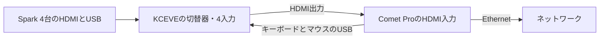

# 上下のSparkの間へ遠隔操作機器の棚を置く

2026年10月12日のユーザー指定で、GL.iNet Comet Pro（GL-RM10）と、KCEVEの4入力1出力のHDMI・USB切替器をラックへ置く設計にしました。[上部専用段の案](上部専用段の具体化.md)では中央用の受け梁を外したため、上下のSparkの間が空いています。そこへ棚を差し込み、前にComet Pro、後ろに切替器を載せました。上下のファンの間に見えていた隙間は、Comet Proの画面の窓を持つ前面板で閉じます。

既定の中央配置では、スイッチがこの高さを使うため棚を置けません。棚は上部専用段の案だけに加え、`mise run upper-bay:spark-rack`で生成します。造形用のファイルは生成しません。

`build/`はGit管理の対象外です。以下のリンクは作業環境での閲覧用で、新しい環境では後述のコマンドで再生成します。

[形状候補の画面](../../../build/spark-rack/upper-switch-bay/20261012-190307-3476c605/fixed-rack.html)と[検査結果](../../../build/spark-rack/upper-switch-bay/20261012-190307-3476c605/validation.json)を保存しました。

## 4台のSparkを1台のComet Proから操作する



Comet Proは、ネットワーク越しに画面を見てキーボードとマウスを操作する機器です。切替器が4台のSparkから1台を選び、その画面とキーボード・マウスをComet Proへつなぎます。どのSparkを操作するかは、切替器のキーボード操作（同名製品の説明書では、Scroll Lockを2回押して番号を押す方法）をComet Pro経由で送って切り替える想定です。この方法で切り替えられるかは実機で確認します。

## 棚の高さは余長収納の予約と下段ファン保持部で決まる

| 対象 | 高さ | 決めた条件 |
|---|---:|---|
| 棚 | 298〜310mm | 下面は分岐ケーブルの余長収納の予約（上端296mm）の上 |
| 機器を載せる面 | 310mm | 下段ファン保持部の上端309.25mmより上。Comet Proを前へ通すため |
| Comet Pro | 310〜357mm | 公式資料の93×84×47mm |
| 切替器 | 310〜350mm | 仮の箱250×120×40mm |
| 前面板 | 309.55〜368.95mm | 下段ファン保持部の上端と、上段ファンを受ける横梁の下面の間 |

最初はComet Proを前面板の直後に置く案を考えました。しかし、上段ファンの下には横梁（下面369.25mm）があり、棚12mmとComet Pro 47mmを重ねると隙間が0.25mmしか残りません。そこでComet Proを下段ファンの後ろへ下げました。ファンの後ろでは、棚を余長収納の予約の上まで下げられます。Comet Proの上には6mmの手の余裕が残ります。

画面は前面板の窓から約31mm奥になります。窓は87×41mmで、Comet Proの前面の約81%が見えます。指を入れてタッチ画面を操作できる深さです。

## Comet Proを前、切替器を後ろに置く

Comet Proの動作温度は0〜40℃です。Sparkと電源の排気は後ろと横へ流れるため、前側へ置いて、前面の窓と溝から室内の空気に触れさせます。これは配置の理由で、温度は測っていません。交換するときは、中央の前面板のねじ2本を外して、Comet Proを前へ引き出します。

切替器は棚の後ろ寄りに置き、背面の端子をSparkの背面へ向けます。端子面はスイッチの端子面と同じ奥行位置です。背面の端子と配線のために50mmの空間を予約しており、この空間は枠の後端から外へ出ます。交換するときは背面へ引き出します。

前面板はPAHT-CF（炭素繊維入りの耐熱ナイロン）の黒で作る予定です。炭素繊維入りの板はWi-Fiの電波を弱める可能性があるため、Comet ProはEthernetでつなぐことを基本にします。

## 前面の隙間を3枚の板で閉じる

| 部品 | 形状候補 |
|---|---|
| 左右の板 | 幅184mm、厚さ4mm。ファンの格子と同じ10mm間隔で、幅7.5mmの縦溝を開ける |
| 中央の板 | 幅120mm。Comet Proの画面の前に87×41mmの角丸の窓を開ける。外すと機器を前へ出せる |
| 受け板 | 各板の下端から後ろへ延び、棚の前の帯へ直径4mmのねじ6本で留める |

上下のファン保持部と同じ前面位置に置き、前面の中段を一続きの面にしました。最上段のスイッチの前の開口、開いた天面、最下段の左右の開口は、この変更では扱っていません。

## 部品数は74から83になる

棚6部品と前面板3部品を加え、印刷候補は83部品になりました。参考形状にはComet Proと切替器の2個が加わり、65個です。形状体積は13.114リットルから14.360リットルへ増えました。内訳は、棚0.863リットル、前面板0.141リットル、棚の受けを加えた側枠0.241リットルの増加です。形状体積は充填率、支持材、印刷損失を含む材料使用量ではありません。

## 検査した範囲

上部専用段と同じ検査に、次を加えました。

- 棚と前面板が閉じた単一形状で、最大246mmの外形に収まること
- 棚が側枠の水平な受けに載り、Comet Pro、切替器、前面板が棚に接すること
- 中央の前面板を外せばComet Proを前へ引き出せること、切替器を背面へ引き出せること
- Comet Proの背面の配線、切替器の前後の端子の予約が、固定物に当たらないこと
- 画面の窓から、Comet Proの前面の75%以上が見えること
- 本体の前後の空間、本体と電源の交換経路、余長収納の予約を塞がないこと

これらはCAD上の確認です。温度、Wi-Fiの届き方、配線の実際の取り回しは検証していません。

## 判断を変える未確定値

- 切替器の型番、実寸、電源の取り方、端子がどの面にあるか。外形が仮の箱より大きければ、棚の上の配置を見直す。
- SparkのHDMIとUSBの端子位置と、切替器から届くケーブルの長さ。
- Comet Proのキーボード入力で切替器を切り替えられるか。
- Comet Pro、切替器、CRS812の交流電源をどこから取るか。電源タップの置き場は未設計。
- ラック内の中段の温度が、Comet Proの動作温度に収まるか。

測った値は[未確定値の記録](../reference/pending-mount-measurements.json)の`remote_console`へ書き込みます。

## 正本から再生成する

| ファイル | 担当する内容 |
|---|---|
| [spark_rack_parameters.py](../source/spark_rack_parameters.py)の`RemoteConsoleParameters` | 棚と前面板の寸法の正本 |
| [rack_accessories.py](../source/rack_accessories.py) | 棚の高さ、機器と配線の予約、交換経路 |
| [accessory_geometry.py](../source/accessory_geometry.py) | 棚と前面板の形状、側枠の受け、ねじ候補 |

機器の外形は[未確定値の記録](../reference/pending-mount-measurements.json)から読みます。切替器の`body_mm`に実寸を書き込めば、仮の箱の代わりに使われます。

```sh
mise trust
mise run upper-bay:spark-rack
node tests/check_fixed_rack_view.cjs build/spark-rack/upper-switch-bay/<実行ID> 83
```
